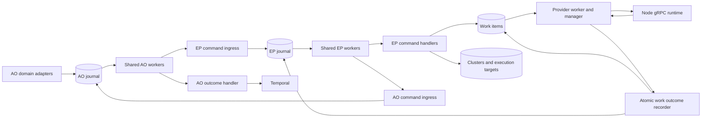

# Execution Plane: Logical Components

AO and EP each own a database and use `execution_plane_client` for their command
journal and handshake workers. Commands request all EP actions. Scoped queries
support observation and recovery. See [integration.md](integration.md).

| Component | Responsibility |
| --- | --- |
| Shared command service | Authenticated receipt, acceptance, immutable envelopes, leased delivery/handling, retries, peer reconciliation |
| EP command handlers | Work execution, cancellation, cluster and target registration/provisioning/update/deletion |
| EP command projections | Scoped command status, resource identity, desired revisions and cancellation intent |
| WorkStore | Provider execution lifecycle and results; atomically invokes completion recording |
| Worker and worker manager | Placement, claim fencing, allocation, gRPC execution and resource cleanup |
| Cluster and target stores | Domain resources and lifecycle state |
| Resource observer and drain monitor | Observe domain convergence and complete resource commands |
| AO activity adapter | Stable command identity and encrypted Temporal-token correlation |
| AO integration adapter | Snapshot integration revisions and credentials into commands |

`commands/service.py` supervises EP's shared workers and resource observer.
There is no separate binding reconciler, completion notifier or completion-event
queue. The journal holds communication responsibility; work items, clusters,
execution targets retain provider domain state. AO keeps Temporal identity, token and attempt in
its private journal context; journal handling/effect records own completion state.
