# Script execution happy path: AO to EP and back

This sequence describes the current happy path using `VanillaK8sWorkerManager`,
from AO submitting a Script command through execution and completion of the
original Temporal activity. It assumes an active, eligible execution target and
successful transport, execution and persistence operations.

The exchange participants group the HTTP API and shared journal workers; these
can run in separate processes. Each participant owns one `exchange_journal`
table in its own database. EP's `WorkItem` retains provider execution state.

```mermaid
sequenceDiagram
    participant T as Temporal
    participant A as AO Script activity
    participant AO as AO exchange<br/>execution_plane_client
    participant AJ as AO PostgreSQL<br/>exchange_journal
    participant EP as EP exchange<br/>execution_plane_client
    participant ED as EP PostgreSQL<br/>exchange_journal + WorkItem
    participant W as EP worker<br/>VanillaK8sWorkerManager
    participant K as Kubernetes API
    participant N as Script node<br/>Job / Pod

    Note over T,N: 1. AO durably submits the Script command

    T->>A: execute_script_activity()
    A->>A: _dispatch_to_ep() → enqueue_script()<br/>Build invocation, image and stable command identity
    A->>AO: MediatorClient.work_execute() → submit()
    AO->>AJ: ExchangeJournalStore.append_outbound(work.execute)<br/>delivery_state = queued
    A->>AJ: ExchangeJournalStore.set_local_context()<br/>Encrypted Temporal identity, attempt and task token
    A->>AJ: COMMIT command and private context together
    AJ-->>AO: PostgreSQL NOTIFY → JournalNotifications._received()<br/>Wake JournalDeliveryWorker
    A->>A: activity.raise_complete_async()
    Note over T,A: Temporal activity remains pending until AO completes it asynchronously

    Note over AO,ED: 2. HTTP submission and durable request acknowledgement

    AO->>AJ: JournalClaims.claim_due_delivery()<br/>Persist fenced delivery claim<br/>COMMIT

    opt Peer capabilities are not cached
        AO->>EP: HttpCommandTransport.get_capabilities()<br/>HTTP GET /v1/capabilities
        EP-->>AO: HTTP 200 — supported command revisions
    end

    AO->>EP: JournalDeliveryWorker._deliver() → HttpCommandTransport.send()<br/>HTTP POST /v1/commands — work.execute
    EP->>EP: receive_command() → CommandReceiptHandler.receive()<br/>Authenticate and validate envelope
    EP->>ED: append_or_confirm_inbound(work.execute)<br/>handling_state = pending
    EP->>ED: acceptance_for() → append_outbound(command.accepted)<br/>ACK identifies the original command_id and message_id
    EP->>ED: COMMIT inbound request and outbound ACK together
    ED-->>EP: PostgreSQL NOTIFY → JournalNotifications._received()<br/>Wake delivery and handling workers
    EP-->>AO: HTTP 202 — TransportReceipt(received=true)
    AO->>AJ: JournalClaims.record_delivery()<br/>delivery_state = sent<br/>COMMIT

    par Deliver the durable request ACK
        EP->>ED: JournalClaims.claim_due_delivery()<br/>Claim command.accepted<br/>COMMIT
        EP->>AO: HttpCommandTransport.send()<br/>HTTP POST /api/execution_plane/v1/commands — command.accepted
        AO->>AO: receive_command() → CommandReceiptHandler.receive()
        AO->>AJ: append_or_confirm_inbound(ACK) + acknowledge()<br/>Original work.execute delivery_state = acknowledged<br/>COMMIT
        AO-->>EP: HTTP 202 — TransportReceipt
        EP->>ED: JournalClaims.record_delivery()<br/>ACK delivery_state = acknowledged<br/>COMMIT
    and Admit the Script for execution
        EP->>ED: JournalClaims.claim_due_handling()<br/>Persist fenced handling claim<br/>COMMIT
        EP->>EP: JournalHandlingWorker._handle()<br/>→ WorkCommandHandler.handle()
        EP->>ED: WorkStore.dispatch()<br/>Insert WorkItem with status PENDING
        EP->>ED: JournalHandlingWorker._finish()<br/>Journal command_status = running, handling_state = handled<br/>Record WorkItem resource reference<br/>COMMIT together
        ED-->>W: PostgreSQL NOTIFY execution_plane_work_items<br/>worker._listen_loop() wakes worker._poll_loop()
    end

    Note over AO,W: ACK delivery and command handling are independent<br/>neither waits for the other

    Note over ED,N: 3. EP executes the Script through the Kubernetes backend

    W->>ED: WorkStore.claim_one()<br/>Assign eligible execution target<br/>WorkItem = CLAIMED<br/>COMMIT
    W->>W: worker._process_item()<br/>Select WorkerManager for target.backend_type
    W->>ED: WorkStore.mark_dispatched()<br/>WorkItem = DISPATCHED<br/>COMMIT
    W->>W: VanillaK8sWorkerManager.dispatch()<br/>Load target, cluster and invocation<br/>call run_job()
    W->>K: run_job() — Kubernetes HTTP API<br/>Create NetworkPolicy and Job
    K->>N: Start configured Script container image
    W->>N: node_protocol.client.invoke()<br/>gRPC NodeService.Health(), then Execute(invocation)
    N->>N: Execute Script
    N-->>W: gRPC stream — progress events and final successful result

    Note over ED,W: 4. Persist execution result and callback responsibility atomically

    W->>W: persist_result_before_cleanup() → persist_result()<br/>_map_result() applies output configuration
    W->>ED: WorkStore.set_result()<br/>Set WorkItem = COMPLETED and store result
    W->>ED: EPCompletionRecorder.__call__() → append_completion()<br/>Append outbound work.execute.completed<br/>Set original journal command_status = succeeded
    W->>ED: COMMIT WorkItem result, journal outcome and completion together
    ED-->>EP: PostgreSQL NOTIFY → JournalNotifications._received()<br/>Wake JournalDeliveryWorker
    W->>K: run_job() cleanup — delete owned Job and NetworkPolicy
    Note over EP,K: Callback delivery can proceed while Kubernetes cleanup finishes

    Note over AO,ED: 5. EP delivers the completion callback to AO

    EP->>ED: JournalClaims.claim_due_delivery()<br/>Claim work.execute.completed<br/>COMMIT

    opt AO capabilities are not cached
        EP->>AO: HttpCommandTransport.get_capabilities()<br/>HTTP GET /api/execution_plane/v1/capabilities
        AO-->>EP: HTTP 200 — supported completion revision
    end

    EP->>AO: JournalDeliveryWorker._deliver() → HttpCommandTransport.send()<br/>HTTP POST /api/execution_plane/v1/commands — work.execute.completed
    Note over AO,EP: Completion target_url = original request callback_url<br/>parent_command_id links completion to work.execute

    AO->>AO: receive_command() → CommandReceiptHandler.receive()<br/>Validate completion and its original command
    AO->>AJ: append_or_confirm_inbound(work.execute.completed)<br/>_observe_completion() records original command_status = succeeded
    AO->>AJ: acceptance_for() → append_outbound(command.accepted)<br/>ACK identifies the completion command and message
    AO->>AJ: COMMIT completion, observed outcome and outbound ACK together
    AJ-->>AO: PostgreSQL NOTIFY → JournalNotifications._received()<br/>Wake delivery and handling workers
    AO-->>EP: HTTP 202 — TransportReceipt
    EP->>ED: JournalClaims.record_delivery()<br/>Completion delivery_state = sent<br/>COMMIT

    par Acknowledge the completion callback
        AO->>AJ: JournalClaims.claim_due_delivery()<br/>Claim completion ACK<br/>COMMIT
        AO->>EP: HttpCommandTransport.send()<br/>HTTP POST /v1/commands — command.accepted
        EP->>EP: receive_command() → CommandReceiptHandler.receive()
        EP->>ED: append_or_confirm_inbound(ACK) + acknowledge()<br/>work.execute.completed delivery_state = acknowledged<br/>COMMIT
        EP-->>AO: HTTP 202 — TransportReceipt
        AO->>AJ: JournalClaims.record_delivery()<br/>ACK delivery_state = acknowledged<br/>COMMIT
    and Complete the original Temporal activity
        AO->>AJ: JournalClaims.claim_due_handling()<br/>Claim inbound completion<br/>COMMIT
        AO->>AO: JournalHandlingWorker._external()<br/>→ TemporalCompletionHandler.prepare()
        AO->>AJ: get_local_context()<br/>Read original activity identity, attempt and task token
        AO->>AJ: JournalHandlingWorker._prepare()<br/>Persist encrypted prepared effect<br/>COMMIT
        AO->>T: TemporalCompletionHandler.execute() → _ready()<br/>WorkflowHandle.describe() via gRPC
        T-->>AO: Confirm the matching activity attempt is started
        AO->>T: AsyncActivityHandle.complete(result) via gRPC
        T-->>AO: Completion accepted<br/>workflow can continue
        AO->>AO: TemporalCompletionHandler.finish()
        AO->>AJ: JournalHandlingWorker._finish()<br/>Completion handling_state = handled<br/>COMMIT
    end
```

## Reading the sequence

- **HTTP `202` is the transport receipt.** The separate `command.accepted`
  message provides the durable protocol acknowledgement. Acceptance messages do
  not generate further acknowledgements; their delivery finishes on HTTP receipt.
- **Completion acceptance and completion handling are separate.** AO can
  acknowledge durable receipt before completing the Temporal activity.
- **Notifications follow commit.** Journal claims and prepared effects also
  commit before HTTP or Temporal RPC calls. Notifications wake workers; the
  journal remains the durable source of truth, with polling as recovery fallback.
- **Concurrent work has no acknowledgement barrier.** The diagram illustrates
  one successful ordering. WorkItem execution can start before the request ACK
  arrives, and Temporal completion can finish before the completion ACK arrives.
  If an ACK arrives before its HTTP response is recorded, `record_delivery()`
  preserves the already-acknowledged state.
- **Command and provider status describe different stages.** The original
  command becomes `running` when EP admits the WorkItem; this includes time
  queued for a provider worker. `WorkItem` tracks the subsequent claim, dispatch
  and execution result.

## Related design

- [Execution plane client design](2026-10-09-execution-plane-client-design.md)
- [Single command journal design](2026-10-12-single-command-journal-design.md)
- [Commit-triggered command dispatch](2026-10-12-command-wakeups-design.md)
